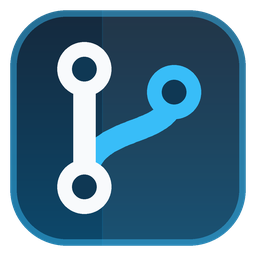

#  GitWorkspace

A native Windows Git GUI with AvalonEdit document tabs, side-by-side diffs, a
commit graph, `git grep` search, ConPTY + xterm.js terminal, and optional
Dart/Go/Python language servers. Built with WPF (.NET 10) — no Electron.

## Requirements

- Windows 10 1809+ or Windows 11
- .NET 10 Desktop Runtime (SDK for building)
- Git for Windows
- Edge WebView2 Runtime
- Node/npm only for the first build (restores the two xterm packages)

Optional for language features:

- Flutter / Dart SDK when the opened repo has `pubspec.yaml`
- `go` + `gopls` when the opened repo has `go.mod` (root or `go/go.mod`)
- Python language server when the opened repo has `pyproject.toml`,
  `requirements.txt`, `setup.py`, `setup.cfg`, or `Pipfile` — prefers
  `basedpyright-langserver`, then `pyright-langserver`, then `pylsp` on PATH
  (also searches common npm / Python install dirs)
- Optional `ruff` on PATH for Python **CLI snapshot**

## Start

```powershell
./Run-GitGui.cmd
# or
./GitGui.ps1
./GitGui.ps1 -Repository D:\path\to\checkout
```

The launcher builds when the executable is missing or sources changed, then
starts `Workspace/bin/Release/net10.0-windows/GitWorkspace.exe`.

### Opening a repository

Resolution order:

1. `--repository <path>` (quotes around the path are stripped)
2. Most recent valid entry in `%LOCALAPPDATA%/GitWorkspace/recent-repos.json`
3. Walk upward from the executable for a `.git` directory
4. Open Folder dialog (cancel exits)

Use **File → Open Repository…** to switch checkouts while running.

## Workflow

- **Explorer** — browse files (including untracked/ignored), edit text in the
  File tab (Ctrl+S / Ctrl+Shift+R), view staged and working-tree diffs.
- **Search** — repository-wide `git grep` with case / word / regex and
  include/exclude globs (Ctrl+Shift+F).
- **Source Control** — stage, commit, pull, push, discard, file history, and
  commit graph with side-by-side revision diffs.
- **Problems** — Dart, gopls, and/or a Python language server start only when
  matching project files exist. **CLI snapshot** runs `flutter analyze` (or
  `dart analyze` when Flutter is absent), `go vet`, and/or `ruff check`.
- **Terminal** — interactive PowerShell via ConPTY; WebView2 + xterm.js loads
  on first open.

Git lock recovery backups live under
`%LOCALAPPDATA%/GitWorkspace/recovered-git-locks/`. Window layout and recent
repos are stored under `%LOCALAPPDATA%/GitWorkspace/`.

## Build and test

```powershell
./Build-Workspace.ps1
./Test-Workspace.ps1
```

Or:

```powershell
dotnet build Workspace/Workspace.csproj -c Release
dotnet run --project SmokeTests/SmokeTests.csproj -c Release
```

Against a Flutter + Go checkout:

```powershell
dotnet run --project SmokeTests/SmokeTests.csproj -c Release -- --analyzers D:\path\to\repo
```

## Releases

Tagged versions (`v*`) build a Windows x64 zip via GitHub Actions and attach it
to the GitHub Release as `GitWorkspace-win-x64.zip`.
